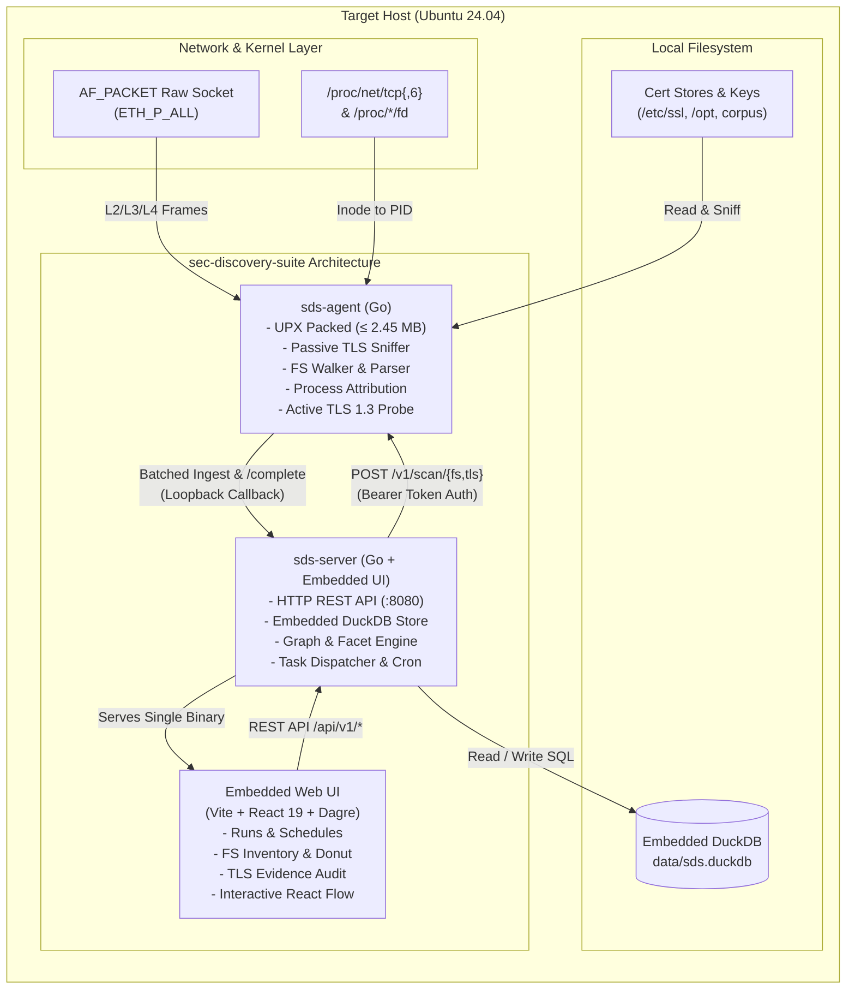

# Cryptographic Discovery Suite (`sec-discovery-suite`)

[](#)
[-10b981)](#)
[](LICENSE)
[](#)

A high-performance, local cryptographic discovery and telemetry suite engineered for Ubuntu Linux. It audits filesystem X.509 certificates and passively observes TLS network connection metadata without capturing application payloads or private-key material.

The suite combines a **statically compiled Go agent (&le; 2.5 MB)**, an **embedded DuckDB analytics engine**, and an **embedded React 19 dashboard with interactive relationship mapping** (`Host` &rarr; `Process` &rarr; `Endpoint` &rarr; `Certificate`).

---

## Architecture Overview

The system operates strictly on a local host boundary with no external cloud dependencies, credentials, or sign-in requirements.



---

## Key Features

- **Ultra-Compact Agent:** Statically compiled in Go (CGO disabled), stripped, and LZMA/UPX compressed down to **2.43 MB** (well under the 4.5 MB budget).
- **Passive TLS Metadata Sniffing:** Hand-parses Ethernet, VLAN, IPv4/IPv6, and TCP frames via `AF_PACKET`. Tracks ClientHello (SNI ext 0), ServerHello (ciphers, ext 43 `supported_versions`, ext 51 `key_share`), and TLS &le; 1.2 Certificate messages.
- **Process Attribution via `/proc`:** Decodes `/proc/net/tcp{,6}` hex addresses, resolves socket inodes to active PIDs by scanning `/proc/*/fd`, and enriches observations with executable path, `comm`, and systemd unit from `/proc/PID/cgroup`.
- **Zero-Storage Application Policy:** Application data records (TLS content type 23) are counted and immediately discarded. Payloads are never copied, stored, or transmitted.
- **Deduplicated Filesystem Inventory:** Automatically sniffs PEM, DER, and PKCS#12 (PFX/P12) formats. Extracts X.509 validity, SANs, key sizes, signature algorithms, and evaluates Post-Quantum Cryptography (PQC) readiness. Computes SHA-256 fingerprints across file instances to separate duplicates from unique credentials.
- **TLS 1.3 Active Probe:** Because TLS 1.3 encrypts handshake certificates on the wire, the agent performs a lightweight, post-capture active TLS handshake (`tls.Dial`) to retrieve and catalog leaf certificates for observed endpoints.
- **Mathematical Audit & Evidence View:** Every aggregated report total is backed by verifiable arithmetic (`/api/v1/runs/{id}/tls/evidence`), detailing event distributions across handshake, application data, and alert records.
- **Cryptographic Relationship Map:** Auto-layout graph driven by Dagre and React Flow connecting `Host` &rarr; `Process` &rarr; `Endpoint` &rarr; `Certificate`. Highlights expiring/classical certificates and computes logarithmic edge observation weights.

---

## Zero-Trust & Metadata-Only Security Model

1. **No Private-Key Exposure:**
   - When encountering PEM blocks labeled `PRIVATE KEY`, the agent inspects permissions and flags `contains_private_key = true` without retaining, logging, or transmitting the key bytes.
   - For PKCS#12 archives, the agent tests an empty password to extract public certificates; any transient private keys parsed in memory are discarded immediately.
2. **No Payload Capture or Decryption:**
   - The sniffer inspects TLS record headers (Content Type, Protocol Version, Length) and initial Handshake protocol bytes.
   - As soon as Application Data (0x17) headers are detected, payload bytes are discarded from the reassembly buffer without buffering.
3. **Loopback-Constrained Command Channel:**
   - The agent command server (`127.0.0.1:7471`) and API server (`127.0.0.1:8080`) bind exclusively to loopback interfaces by default.
   - The agent strictly validates `callback_base` URLs, rejecting any destination outside `127.0.0.1`, `::1`, or `localhost` (HTTP 400) to prevent remote data exfiltration.
4. **Constant-Time Ingest Authentication:**
   - Both the agent and backend enforce shared bearer tokens validated via `crypto/subtle.ConstantTimeCompare`. If `SDS_TOKEN` is unspecified, the backend generates an ephemeral 32-character hexadecimal token on startup.

---

## Linux Privilege Model & Capabilities

The server runs completely unprivileged. The agent requires three specific Linux capabilities to operate:

| Capability | Purpose | Security Rationale |
|---|---|---|
| `CAP_NET_RAW` | Required for `socket(AF_PACKET, SOCK_RAW, htons(ETH_P_ALL))` | Enables passive network frame capture across local interfaces without requiring full root. |
| `CAP_DAC_READ_SEARCH` | Allows reading certificates in restricted directories | Required to audit protected locations like `/etc/ssl/private` or restricted service folders. |
| `CAP_SYS_PTRACE` | Allows reading `/proc/*/fd` of other user processes | Required to correlate socket inodes with process PIDs and binaries owned by other users (e.g., `nginx`, `systemd`). |

### Setting Capabilities via `scripts/caps.sh`
```bash
# Grant file capabilities to the compiled agent binary:
./scripts/caps.sh bin/sds-agent
```
*Note: In environments where setting file capabilities on UPX-compressed binaries is restricted, run `sds-agent` under `sudo` for full capture capabilities.*

---

## Building from Source

### Prerequisites
- **OS:** Ubuntu Linux (tested on 24.04 LTS)
- **Go:** 1.22+
- **Node.js:** v20+ / npm v10+
- **Packages:** `make`, `gcc`, `g++`, `upx-ucl`, `openssl`, `curl`, `jq`

```bash
# Clone the repository
git clone https://github.com/alvin-alvo/sec-discovery-suite.git
cd sec-discovery-suite

# 1. Build the Agent (<2.5MB UPX binary)
make agent

# 2. Build the Server (compiles UI and embeds into Go binary)
make server

# 3. Generate Seed Certificate Corpus for testing
make seed

# 4. Run test suites across all modules
make test
```

### Verifying Agent Binary Size
The project includes a mandatory budget check enforcing that the agent binary remains &le; 4.5 MB:
```bash
./scripts/check-size.sh bin/sds-agent 4500000
# Output: bin/sds-agent size: 2435208 bytes (max allowed: 4500000 bytes) - PASS
```

---

## Quickstart (Local Run)

```bash
# 1. Export authentication token
export SDS_TOKEN=$(openssl rand -hex 16)

# 2. Start Agent in serve mode (terminal 1)
sudo SDS_TOKEN=$SDS_TOKEN ./bin/sds-agent serve

# 3. Start Backend & UI (terminal 2)
SDS_TOKEN=$SDS_TOKEN SDS_AGENT_ADDR=http://127.0.0.1:7471 SDS_DB=data/sds.duckdb ./bin/sds-server

# 4. Open Dashboard in Browser
# Navigate to: http://127.0.0.1:8080
```

---

## Known Limitations

1. **Capture Tier (AF_PACKET vs eBPF):**
   - The architecture was designed with an optional eBPF tracepoint fallback tier. The production engine implements **AF_PACKET raw sockets** (`ETH_P_ALL`), which delivers universal compatibility across Linux kernels without requiring kernel header compilation or BTF runtime dependencies.
2. **TLS 1.3 Certificate Visibility:**
   - Because TLS 1.3 encrypts the server's Certificate message, passive network sniffers cannot observe peer certificates on the wire. `sec-discovery-suite` resolves this by executing a bounded, post-capture **Active TLS Probe** (`tls.Dial` with `InsecureSkipVerify: true`) to retrieve and index the leaf certificate without participating in the passive capture session.
3. **Scope & Protocol Boundaries:**
   - QUIC / HTTP/3 (UDP-based) is out of scope for the current TCP sniffer.
   - Encrypted Client Hello (ECH) will mask the SNI field on supported servers.
   - Container network namespaces (Docker/Kubernetes bridge interfaces) require running the sniffer inside the host network namespace.

---

## AI Disclosure

In accordance with transparent engineering disclosure requirements:
- **Google Antigravity** and **Anthropic Claude** were utilized for pair programming, test suite generation, and frontend component scaffolding.
- All cryptographic parsing logic, packet handling, and DuckDB schemas were verified with deterministic unit and integration test suites.

---

## License

GNU General Public License v3.0 (GPLv3). See [LICENSE](LICENSE) for details.
