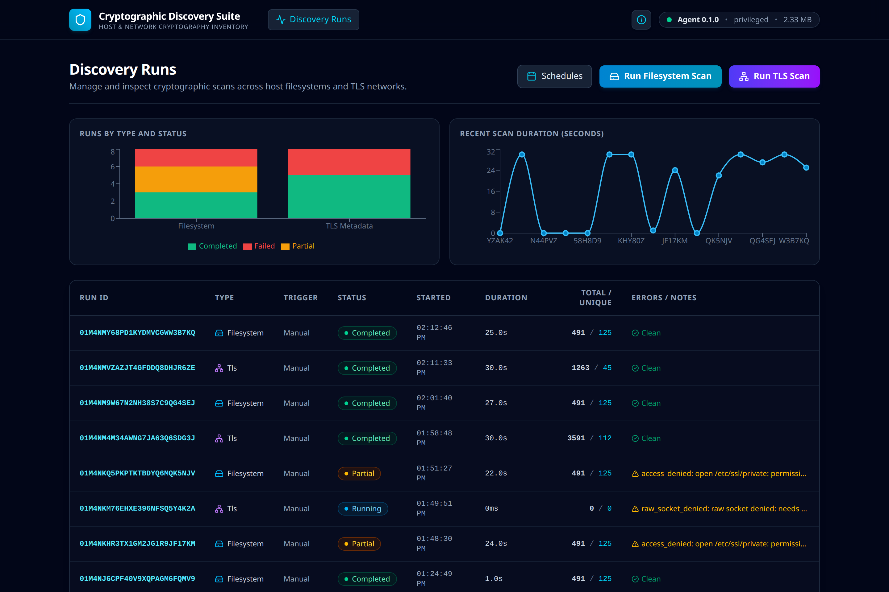
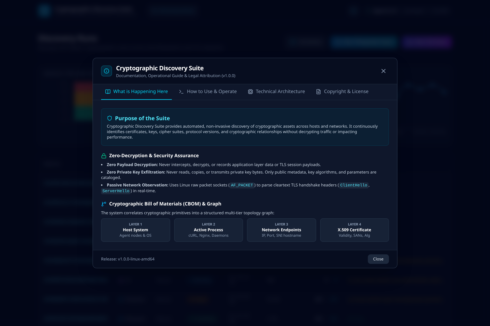
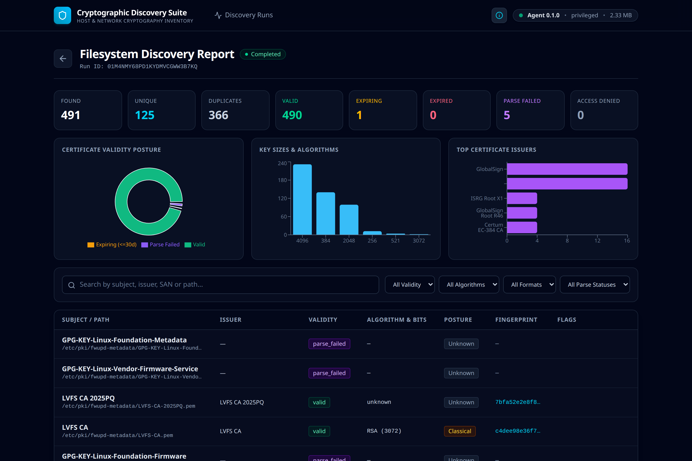
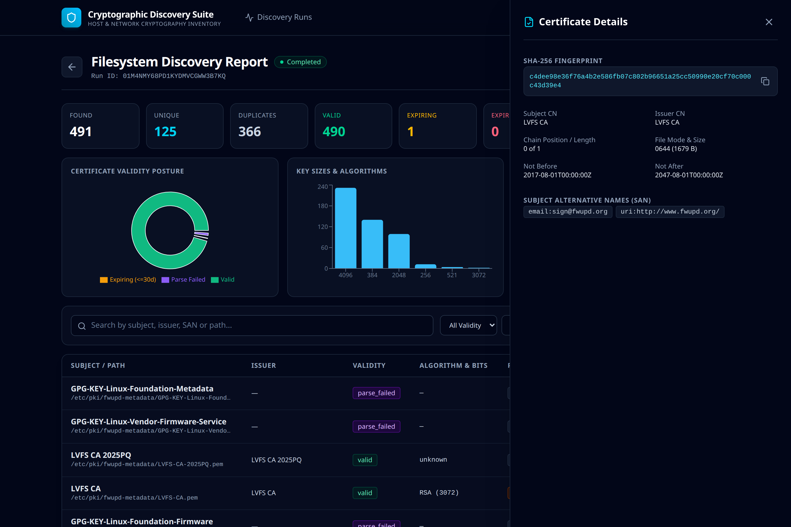
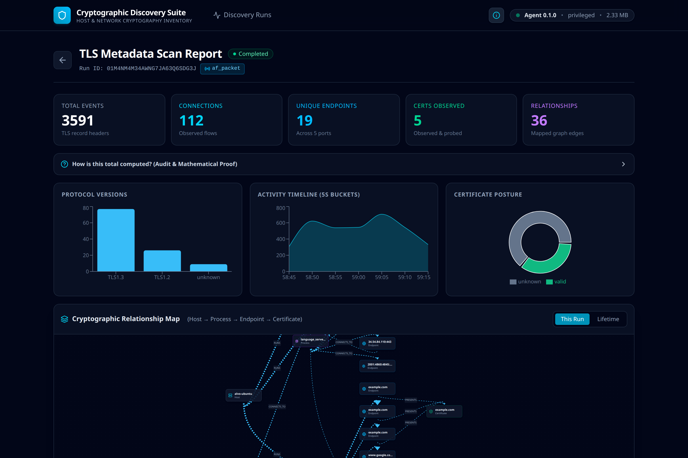
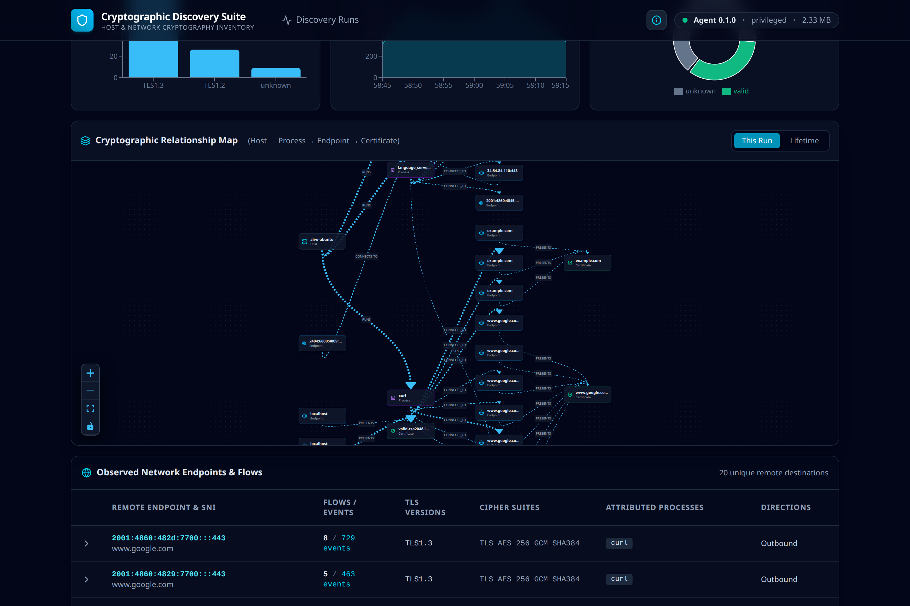
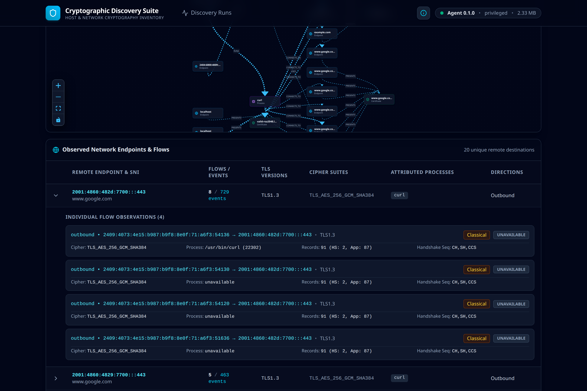
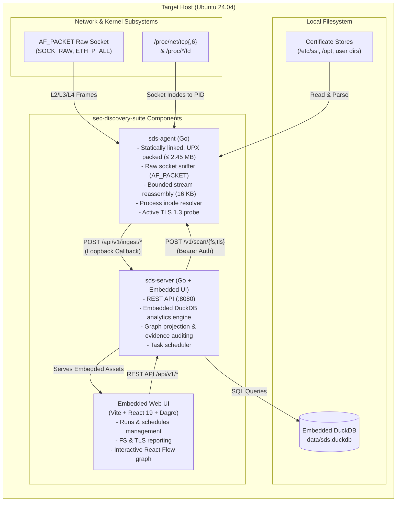

# Cryptographic Discovery Suite (`sec-discovery-suite`)

[](https://github.com/alvin-alvo/sec-discovery-suite/releases/latest)
[](#)
[-10b981)](#)
[](LICENSE)
[](#)

A high-performance cryptographic discovery and network telemetry platform engineered for Ubuntu Linux. The suite audits filesystem X.509 certificates and passively observes TLS network connection metadata without capturing application payloads or private-key material.

The platform consists of a statically compiled Go agent (&le; 2.5 MB packed), an embedded DuckDB analytics server, and an embedded React 19 web dashboard featuring automated relationship mapping (`Host` &rarr; `Process` &rarr; `Endpoint` &rarr; `Certificate`).


---

## Standalone Binary Release (Direct Download)

Pre-built Linux x86_64 binaries are available directly on the [GitHub Latest Release Page](https://github.com/alvin-alvo/sec-discovery-suite/releases/latest).

Reviewers and users can test the complete suite on Ubuntu in under 60 seconds without installing Go, Node.js, DuckDB, or compiler toolchains:

```bash
# 1. Download release bundle from the latest release
curl -sLO https://github.com/alvin-alvo/sec-discovery-suite/releases/latest/download/sds-v1.0.0-linux-amd64.tar.gz


# 2. Verify SHA-256 checksum
echo "d23f85dc95f2108449e99ab63d5d085a9b7924b78b718c2ccd83502673242044  sds-v1.0.0-linux-amd64.tar.gz" | sha256sum --check


# 3. Extract and launch
tar -xzf sds-v1.0.0-linux-amd64.tar.gz
cd sds-v1.0.0-linux-amd64
./start.sh
```

The `./start.sh` launcher initializes the agent and server, opens `http://127.0.0.1:8080` in your default browser, and synchronizes secure authentication tokens automatically.

---


## Overview

The suite provides complete cryptographic visibility into local Linux environments by combining two complementary discovery engines:

1. **Filesystem Certificate Auditing:** Recursively traverses target directory trees to inventory X.509 certificates across PEM, DER, and PKCS#12 containers. Extracts validity ranges, subject alternative names (SANs), signature algorithms, and key sizes. Computes SHA-256 certificate fingerprints to deduplicate identical certificates stored across multiple filesystem locations. Detects associated private keys and resolves file ownership to active local processes.
2. **Passive TLS Network Telemetry:** Captures raw network frames via `AF_PACKET` sockets to passively reconstruct TLS 1.2 and TLS 1.3 handshakes. Reassembles TCP segments up to a bounded 16 KB window to extract ClientHello (SNI, supported ciphers, supported groups/extensions) and ServerHello parameters. Correlates network connections to local processes (PIDs, binary paths, systemd units) by inspecting `/proc/net/tcp` and `/proc/*/fd`.
3. **Active Post-Capture TLS 1.3 Probing:** Solves the TLS 1.3 encrypted certificate dilemma by performing a lightweight, non-intrusive TLS handshake against discovered endpoints immediately following the capture window, cataloging server certificate chains without intercepting application data.
4. **Relational Graph Modeling:** Persists observations into an embedded DuckDB database and projects a directed relationship graph connecting host instances, executing processes, network endpoints, and presented certificates.

---

## Quickstart

### Prerequisites
- Ubuntu Linux (tested on 24.04 LTS)
- Pre-built binaries in `bin/` (`bin/sds-agent` and `bin/sds-server`)

### 1. Start the Agent (Terminal 1)
The agent requires elevated network capture capabilities (`CAP_NET_RAW`, `CAP_SYS_PTRACE`, `CAP_DAC_READ_SEARCH`):
```bash
sudo ./bin/sds-agent serve
```
*Expected output: `sds-agent serving on 127.0.0.1:7471`*

### 2. Start the Server and Dashboard (Terminal 2)
The backend server manages DuckDB storage, scheduled dispatching, and serves the embedded UI:
```bash
./bin/sds-server
```
*Expected output: `sds-server listening on http://127.0.0.1:8080`*

*(Note: The agent and server automatically generate and synchronize a secure bearer token via local `.sds_token`. You can optionally supply an explicit token in both terminals using `export SDS_TOKEN=<token>`.)*

### 4. Access the Dashboard
Open your browser and navigate to:
```
http://127.0.0.1:8080
```

---

## Operating Instructions

### Primary Navigation
The web interface is organized into three primary views:
- **Discovery Runs (`/runs`):** Monitor agent health, launch ad-hoc scans, inspect historical runs, and configure background scan schedules.
- **Filesystem Discovery Report (`/runs/:id/fs`):** Detailed inventory of disk certificates, validity status, cryptographic algorithms, duplicate counts, and file ownership.
- **TLS Telemetry Report (`/runs/:id/tls`):** Observed network flows, protocol versions, process attribution, evidence auditing, and the interactive relationship graph.

---

### Step 1: Running a Filesystem Certificate Audit
1. Open the dashboard at `http://127.0.0.1:8080`.
2. Confirm the agent status chip in the top-right header displays `Agent v0.1.0 • privileged`.
3. Click **Run Filesystem Scan** in the header.
4. A new run appears in the table with status `running`, completing in 1-3 seconds.
5. Click the completed run row to open the **Filesystem Discovery Report**:
   - **Summary Metrics:** Review Total Found, Unique Fingerprints, Duplicate Instances, Valid, Expiring (<30 days), and Expired counts.
   - **Coverage Banner:** If the status is `partial`, the banner identifies directories that were safely skipped due to OS permissions (e.g., `/restricted_dir`), confirming that scanning completed across all accessible paths without failure.
   - **Charts:** Inspect the Validity Distribution donut chart and Key Algorithm breakdown bars (e.g., RSA 2048, ECDSA P-256).
   - **Certificate Table:** Use the search bar to filter by domain, fingerprint, or status.
   - **Inspection Drawer:** Click any certificate row to open the drawer detailing full SHA-256 fingerprints, SAN lists, file paths, permissions, and owner process information. Badges indicate attributes like `PRIVATE KEY PRESENT` or `SYMLINK`.

---

### Step 2: Observing Live TLS Network Traffic
TLS discovery uses purely passive, non-intrusive packet capture (`AF_PACKET` raw sockets). The agent captures 100% genuine system network traffic passing through the kernel. Zero mock or synthetic data is ever injected into production scans.

Because observation is passive, TLS handshakes must actively occur during the scan window to be captured. If no applications initiate TLS connections during the window, the scan legitimately reports 0 observations.

- **Real System Traffic:** Legitimate system activity (web browsing, API requests, `curl`, `git fetch`, package managers, background daemon connections) is immediately captured and mapped to its originating process.
- **Simulating Test Traffic (Optional):** In testing or evaluation environments without natural background traffic, launch the included test traffic script in a separate terminal:
  ```bash
  ./scripts/gen-traffic.sh 40
  ```
  *This starts local test services on port 8443 (TLS 1.2) and port 8444 (TLS 1.3), issuing test requests for 40 seconds.*

1. In the web dashboard header, click **Run TLS Scan**.
3. The agent initiates an `AF_PACKET` capture session for 30 seconds. A progress indicator tracks elapsed time.
4. Once complete, click the run row to view the **TLS Metadata Report**:
   - **Metrics:** Displays Total Events, Connections, Endpoints, Certificates Observed, and Graph Relationships.
   - **Evidence Audit Expander:** Click *"How is this total computed?"* to inspect the mathematical breakdown of observed events across Handshake, Application Data, and Alert records.
   - **Observed Network Flows:** Expand any destination endpoint to inspect individual connections:
     - **TLS Version:** Shows negotiated protocol (`TLS 1.2` or `TLS 1.3`).
     - **Cipher Suite:** Plaintext cipher suite negotiated (e.g., `TLS_AES_128_GCM_SHA256`).
     - **Process Attribution:** Identifies the originating process name and PID (e.g., `curl [PID 8492]`).
     - **Certificate Source:** Indicates `observed` for passively captured TLS 1.2 certificates, or `probed` for TLS 1.3 certificates retrieved via post-capture active probe.
     - **PQC Posture:** Flags cryptographic classification (`Classical`, `Hybrid`, or `PQC`).

---

### Step 3: Interacting with the Relationship Map
Scroll to the lower section of the TLS Report to interact with the **Cryptographic Relationship Map**:
- **Graph Topology:** Visual layout organized hierarchically using Dagre:
  `Host` &rarr; `Process` &rarr; `Endpoint` &rarr; `Certificate`
- **Interactive Inspection:** Click any node (Process, Endpoint, or Certificate) to open its property inspector with timestamps, network addresses, and metadata.
- **Edge Weighting:** Edge stroke widths are scaled logarithmically based on observation counts.
- **Risk Ring Indicators:** Nodes with expired or weak cryptographic configurations display red or amber status rings.
- **Scope Toggle:** Switch between **This Run** (edges observed within the current scan) and **Lifetime** (cumulative host graph across all runs).

---

### Step 4: Configuring Automated Background Schedules
1. In the header bar, click **Schedules**.
2. Toggle the switch to active for either Filesystem or TLS scans.
3. Select an execution interval:
   - `30 seconds (demo)`: For rapid validation and continuous testing.
   - `15 minutes`, `1 hour`, `6 hours`, `24 hours`: For operational deployments.
4. Scheduled executions trigger automatically in the background and are recorded with `Trigger: Scheduled`.

---

### Command-Line Interface (Headless Mode)
Scans can be executed directly from the terminal without the web dashboard:

```bash
# Filesystem scan with human-readable output
./bin/sds-agent scan fs

# Filesystem scan with JSON Lines streaming output
./bin/sds-agent scan fs --json

# Passive TLS capture for 15 seconds
sudo ./bin/sds-agent scan tls --duration 15s

# Passive TLS capture with structured JSON output
sudo ./bin/sds-agent scan tls --duration 15s --json
```

---

## Feature Walkthrough & Visual Tour

### 1. Unified Discovery Runs Dashboard
Monitor agent health, observe recent execution history across filesystem and network discovery, and inspect live operational run metrics.



Key capabilities:
- Real-time agent status chip reporting version, privilege level, and packed binary memory footprint.
- Historical scan histogram and execution duration timelines.
- One-click triggers for Filesystem audits and passive TLS network captures.
- Background automated scan scheduler modal.

---

### 2. In-App Documentation, Operational Guide & Copyright Modal
Click the information `i` button in the top navigation bar to access full in-app architectural documentation, operation procedures, and legal attribution without leaving the interface.



Key capabilities:
- Architectural explanation of passive packet capture and CBOM projection layers.
- Operational guide detailing manual triggers, CLI usage, and test traffic generation.
- Full GPLv3 license terms and copyright attribution to Alvin Alvo ([https://github.com/alvin-alvo/sec-discovery-suite](https://github.com/alvin-alvo/sec-discovery-suite)).
- Complete attribution of embedded open-source libraries (DuckDB, React Flow, TanStack Query, Lucide).

---

### 3. Filesystem Certificate Discovery & Deduplication Report
Traverse host directory trees, detect X.509 certificates across PEM, DER, and PKCS#12 formats, and deduplicate certificates by SHA-256 fingerprint.



Key capabilities:
- Executive summary metrics: Total found, unique fingerprints, duplicate references, valid, expiring (<=30d), and expired.
- Dynamic infinite-scroll table loading certificates on demand via TanStack Query and IntersectionObserver sentinels.
- Validity posture donut chart and key algorithm distribution histogram (RSA 2048/4096, ECDSA P-256/P-384, Ed25519).
- Faceted filtering by algorithm, validity status, container format, and parse health.

---

### 4. Slide-Out Certificate Inspection Drawer
Click any certificate row in the filesystem report to slide out an in-depth cryptographic property inspector.



Key capabilities:
- Full SHA-256 certificate fingerprint with one-click clipboard copying.
- Complete Subject Alternative Names (SAN) parsing (DNS names, email addresses, URIs, IP addresses).
- Certificate chain position, file system permissions, and file size in bytes.
- Exact validity window (`Not Before` and `Not After` timestamps).
- Process ownership resolution attributing certificates to active system processes and users.

---

### 5. Passive TLS Metadata Telemetry Report
Passively observe live TLS network connections traversing system interfaces via Linux raw sockets (`AF_PACKET`) without session termination or decryption.



Key capabilities:
- Real-time telemetry counters tracking observed packets, flows, unique endpoints, and certificates.
- Mathematical Evidence Audit Expander: Audits exact event sums (`Total Events = Handshake + Application Data + Alert`).
- Protocol breakdown charts highlighting TLS 1.2 vs. TLS 1.3 usage across system connections.
- Activity timeline tracking connection rates across 5-second buckets.

---

### 6. Interactive Cryptographic Relationship Map
Project discovered assets into a multi-tier directed acyclic graph linking `Host` -> `Process` -> `Endpoint` -> `Certificate`.



Key capabilities:
- Dagre-directed hierarchical graph layout powered by React Flow with custom dark-slate node styling.
- High-contrast zoom and viewport controls designed for dark-mode operational environments.
- Prominent amber and red risk rings highlighting expired certificates or deprecated algorithms.
- Scope toggle supporting single-run topology vs. cumulative host lifetime graph.

---

### 7. Deep Network Flow & Cipher Suite Inspection
Expand destination endpoint rows to view individual network flows, attributed system processes, and negotiated cryptographic parameters.



Key capabilities:
- Plaintext cipher suite identification (e.g., `TLS_AES_256_GCM_SHA384`, `TLS_ECDHE_RSA_WITH_AES_128_GCM_SHA256`).
- Process attribution mapping socket inodes directly to executing binaries (e.g., `/usr/bin/curl [PID 22302]`).
- Direction classification (`Outbound` vs. `Inbound`).
- Handshake sequencing verification (`ClientHello`, `ServerHello`, `ChangeCipherSpec`).
- Post-Quantum Cryptography (PQC) classification flags (`Classical`, `Hybrid`, `PQC`).

---

## Technical Architecture




---

## Deep Technical Specifications

### 1. Passive TLS Sniffer Engine (`afpacket_linux.go`, `tlsparse.go`, `reasm.go`)
- **Raw Socket Capture:** Initializes an `AF_PACKET` raw socket bound to `ETH_P_ALL` using `SOCK_RAW`. Bypasses standard transport stacks to receive frames across all interfaces.
- **Loopback Deduplication:** On the Linux loopback interface (`lo`), the kernel delivers both egress and ingress packets to raw socket listeners. The sniffer tracks the interface index and evaluates `sockaddr_ll.pkttype`. Outgoing loopback frames (`PACKET_OUTGOING`) are filtered to prevent double-counting connections.
- **Packet Protocol Decoding:** Hand-crafted binary parsers decode Ethernet headers (handling 802.1Q VLAN tags), IPv4 and IPv6 packet headers, and TCP segment headers without third-party C/pcap dependencies.
- **Bounded Stream Reassembly:** Reassembles out-of-order TCP segments on a per-flow 4-tuple key (`src_ip:src_port` &rarr; `dst_ip:dst_port`). Flow state is bounded to a maximum buffer of 16 KB per stream to capture initial TLS handshakes while bounding memory overhead.
- **TLS Record Parsing:** Decodes TLS Record Layer headers:
  - Content Type 20 (ChangeCipherSpec)
  - Content Type 21 (Alert)
  - Content Type 22 (Handshake)
  - Content Type 23 (Application Data)
- **Handshake Message Extraction:**
  - **ClientHello:** Parses extension 0 (Server Name Indication / SNI), extension 43 (`supported_versions`), and extension 51 (`key_share` / named groups).
  - **ServerHello:** Parses negotiated cipher suite, protocol version, and key exchange group.
  - **Certificate (TLS &le; 1.2):** Parses ASN.1 DER certificate sequences transmitted in plaintext.
- **Post-Quantum Cryptography (PQC) Evaluation:** Inspects supported groups and key shares for post-quantum algorithms (e.g., X25519MLKEM768, ML-KEM-768). Classifies connection posture as `Classical`, `Hybrid`, or `PQC`.

### 2. Active Post-Capture TLS 1.3 Probe (`probe.go`)
- **Problem Statement:** In TLS 1.3, the server's `Certificate` message is encrypted under handshake keys derived from ephemeral Diffie-Hellman exchanges. Passive listeners cannot extract certificate metadata on the wire.
- **Solution Architecture:** When the passive sniffer observes a completed TLS 1.3 handshake on an endpoint where no certificate was captured, the agent schedules a post-capture probe.
- **Execution:** Immediately following the capture window, the agent issues a lightweight `tls.Dial` with a 3-second timeout and `InsecureSkipVerify: true`. It retrieves the peer certificate chain directly from the TLS connection state and immediately closes the connection, achieving complete certificate visibility without decrypting user payloads.

### 3. Process Attribution Subsystem (`procnet.go`, `/proc/*/fd`)
- **Kernel State Inspection:** Reads `/proc/net/tcp` and `/proc/net/tcp6` to obtain active local socket states. Decodes hexadecimal local and remote address representations into standard network byte order.
- **Inode Mapping:** Matches the 4-tuple connection endpoint to the kernel socket inode number.
- **File Descriptor Traversal:** Scans `/proc/[pid]/fd/` for running processes, inspecting symlinks targeting `socket:[<inode>]`.
- **Metadata Enrichment:** Upon finding a matching inode, extracts:
  - Process ID (PID)
  - Binary executable path via `/proc/[pid]/exe`
  - Command name via `/proc/[pid]/comm`
  - Systemd service unit via `/proc/[pid]/cgroup`

### 4. Filesystem Discovery Engine (`fsscan.go`, `certinfo/`)
- **Container Formats:** Sniffs and parses X.509 certificates stored in:
  - PEM blocks (`BEGIN CERTIFICATE`)
  - Raw binary ASN.1 DER files
  - PKCS#12 archives (`.p12`, `.pfx`), parsed using empty password extraction for public certificates
- **Symlink Protection:** Resolves canonical paths and maintains an inode visit set to prevent infinite loops caused by cyclic symbolic links.
- **Deduplication Strategy:** Calculates the SHA-256 hash across raw public certificate bytes. Multiple filesystem instances sharing an identical fingerprint are aggregated under a single logical certificate record with multiple location references.
- **Private Key Safeguards:** Detects adjacent or embedded `PRIVATE KEY` blocks. When identified, sets `contains_private_key = true` and records file permissions without reading, logging, or storing private-key bytes.

### 5. Embedded Analytics and Data Model (DuckDB)
The server embeds DuckDB via CGO bindings, operating against `data/sds.duckdb`:
- **Core Relations:**
  - `discovery_runs`: Execution state, scan type (`fs`, `tls`), trigger origin, timestamps, error summaries.
  - `fs_certificates`: Ingested certificate attributes, validity dates, SAN lists, key algorithms, fingerprints, duplicate counts, owner processes.
  - `tls_observations`: Captured connection events, 4-tuple addresses, TLS versions, cipher suites, PQC classifications, PIDs.
  - `tls_evidence_counts`: Event counts partitioned by record type (handshake, application data, alert) for mathematical verification.
  - `graph_nodes` & `graph_edges`: Materialized graph entities and directed relationships with observation weights.
- **Evidence Verification Query:**
  The server provides an evidence endpoint (`/api/v1/runs/{id}/tls/evidence`) computing:
  $$\text{Total Events} = \text{Handshake Events} + \text{Application Data Events} + \text{Alert Events}$$
  Ensuring full auditability between captured wire packets and displayed metrics.

---

## Security and Zero-Trust Model

1. **Zero Payload Retention:** Application data records (TLS content type 23) are counted at the record header and immediately discarded from the reassembly buffer. Payload data is never buffered, stored to disk, or transmitted.
2. **Zero Private-Key Material Exposure:** Private key bytes are never extracted or saved. The presence of private keys is noted solely as a security boolean (`contains_private_key = true`).
3. **Loopback-Constrained IPC:** Both the agent command listener (`127.0.0.1:7471`) and server API (`127.0.0.1:8080`) bind exclusively to loopback interfaces. The agent validates `callback_base` URLs and rejects any target outside `127.0.0.1`, `::1`, or `localhost` (HTTP 400).
4. **Constant-Time Authentication:** Requests between the server, agent, and clients are authenticated using a shared bearer token validated via `crypto/subtle.ConstantTimeCompare`.
5. **No External Network Dependencies:** The platform requires no internet connectivity, external SaaS dependencies, or third-party cloud telemetry.

---

## Linux Privilege Model and Capabilities

The backend server runs entirely unprivileged. The agent requires three Linux capabilities:

| Capability | Kernel Purpose | Operational Rationale |
|---|---|---|
| `CAP_NET_RAW` | Required for `socket(AF_PACKET, SOCK_RAW, ...)` | Allows passive capture of network frames across network devices. |
| `CAP_DAC_READ_SEARCH` | Bypasses file read and directory search checks | Enables auditing certificates in protected stores (e.g., `/etc/ssl/private`). |
| `CAP_SYS_PTRACE` | Allows reading `/proc/[pid]/fd` of other users | Enables mapping network socket inodes to processes owned by other system users. |

### Assigning Capabilities via `scripts/caps.sh`
```bash
./scripts/caps.sh bin/sds-agent
```
*Note: In environments where setting file capabilities on compressed binaries is prohibited by the filesystem, running the agent with `sudo` is the standard operational path.*

---

## Building from Source

### Requirements
- **OS:** Ubuntu Linux 24.04 LTS
- **Go:** 1.22+
- **Node.js:** v20+ / npm v10+
- **Build Tools:** `make`, `gcc`, `g++`, `upx-ucl`, `openssl`, `curl`, `jq`

```bash
# Clone repository
git clone https://github.com/alvin-alvo/sec-discovery-suite.git
cd sec-discovery-suite

# 1. Compile Agent (produces UPX-compressed static binary in bin/sds-agent)
make agent

# 2. Compile Server (builds React 19 UI and embeds into bin/sds-server)
make server

# 3. Generate Test Certificate Corpus
make seed

# 4. Execute Full Test Suite
make test
```

### Binary Size Enforcement
The agent binary size is restricted to &le; 4.5 MB. The build pipeline enforces this constraint:
```bash
./scripts/check-size.sh bin/sds-agent 4500000
# Expected output:
# bin/sds-agent size: 2435208 bytes (max allowed: 4500000 bytes)
# PASS: bin/sds-agent (2435208 bytes) is within budget (4500000 bytes)
```

---

## REST API Reference

| Method | Endpoint | Description |
|---|---|---|
| `GET` | `/api/v1/runs` | List discovery runs with execution status and summary counts |
| `POST` | `/api/v1/scan/fs` | Trigger an ad-hoc filesystem certificate scan |
| `POST` | `/api/v1/scan/tls` | Trigger an ad-hoc passive TLS network scan |
| `GET` | `/api/v1/runs/{id}` | Retrieve execution details for a specific run |
| `GET` | `/api/v1/runs/{id}/fs/summary` | Retrieve aggregated filesystem metrics and validity facets |
| `GET` | `/api/v1/runs/{id}/fs/certificates` | Query discovered certificate records (supports pagination/search) |
| `GET` | `/api/v1/runs/{id}/tls/summary` | Retrieve aggregated TLS observation metrics |
| `GET` | `/api/v1/runs/{id}/tls/observations` | Query observed TLS connection flows (`?group=none|endpoint`) |
| `GET` | `/api/v1/runs/{id}/tls/evidence` | Mathematical audit breakdown of observed TLS record headers |
| `GET` | `/api/v1/runs/{id}/tls/graph` | Directed relationship graph (`?scope=run|lifetime`) |
| `GET` | `/api/v1/schedules` | Retrieve current background scan schedules |
| `PUT` | `/api/v1/schedules/{type}` | Update background scan schedule configuration |

---

## Known Limitations

1. **Transport Boundary:** The sniffer inspects TCP-based TLS traffic. UDP-based protocols (QUIC / HTTP/3) are not parsed by the current TCP reassembly pipeline.
2. **Encrypted Client Hello (ECH):** In environments utilizing ECH, the Server Name Indication (SNI) outer extension is encrypted, limiting passive domain attribution.
3. **Container Network Namespaces:** Packet sniffing on host interfaces does not observe traffic confined entirely within isolated container bridge networks without attaching to the target network namespace.

---

## AI Disclosure

In accordance with transparent engineering disclosure:
- Google Antigravity and Anthropic Claude were utilized for pair programming, test generation, and frontend component scaffolding.
- All cryptographic parsing, raw packet decoding, and DuckDB schemas were verified with deterministic unit and integration test suites.

---

## License and Copyright

Copyright (C) 2026 Alvin Alvo ([https://github.com/alvin-alvo/sec-discovery-suite](https://github.com/alvin-alvo/sec-discovery-suite)). All rights reserved.

Licensed under the GNU General Public License v3.0 (GPLv3). See [LICENSE](LICENSE) for details.

