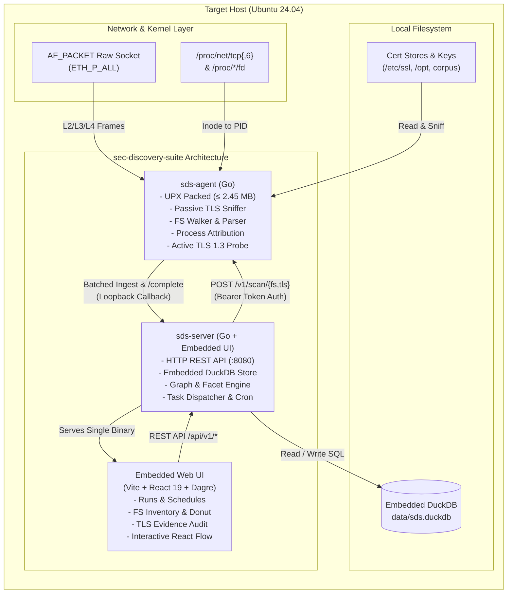

# Cryptographic Discovery Suite (`sec-discovery-suite`)

[](#)
[-10b981)](#)
[](LICENSE)
[](#)

> **Think of this as an automated X-Ray for your server's SSL/TLS certificates and encrypted network connections.**
>
> It scans your local files to catalog every certificate on disk, catches expiring or duplicate certs before they take your services down, and passively listens to network traffic to map which running programs are talking to which websites and over what encryption protocols.
>
> **100% Local & Zero-Trust:** Never reads passwords, never captures private keys, never records message payloads, and requires zero external cloud connections.

---

## What Does This Tool Do? (In 30 Seconds)

1. **Finds Every Certificate on Disk (Filesystem Discovery):**
   Scans your folders to find SSL/TLS certificates (`.pem`, `.crt`, `.der`, `.p12`). It checks if any are **expired** or **expiring soon**, calculates cryptographic fingerprints to flag **wasted duplicates**, and identifies which local process (e.g., Nginx, Apache) owns them.
2. **Watches Active Encrypted Connections (TLS Network Observation):**
   Passively listens to network traffic for 15–30 seconds. It detects which apps (e.g., `curl`, Python, background daemons) are connecting over TLS, what TLS version is negotiated (modern **TLS 1.3** vs legacy **TLS 1.2**), and what cipher suites are used.
3. **Draws an Interactive Cryptographic Map:**
   Automatically builds a visual diagram linking your **Host** &rarr; **Running Programs (PIDs)** &rarr; **Remote Endpoints** &rarr; **Certificates**.
4. **Safety Guarantee:**
   Application data payloads (chat messages, database queries, web traffic) are dropped at the packet header level without ever being buffered or saved. Private keys are never read or stored.

---

## ⚡ Quickstart: Get Running in 60 Seconds

You need two terminal windows open:

```bash
# In your terminal, set an authentication token:
export SDS_TOKEN=$(openssl rand -hex 16)
```

### Terminal 1: Start the Agent (Collector)
```bash
# Run the lightweight agent with sudo (needed for raw packet sniffing):
sudo SDS_TOKEN=$SDS_TOKEN ./bin/sds-agent serve
```
*You will see: `sds-agent serving on 127.0.0.1:7471`*

### Terminal 2: Start the Server & Web Dashboard
```bash
# Run the API server with embedded DuckDB and React dashboard:
SDS_TOKEN=$SDS_TOKEN SDS_AGENT_ADDR=http://127.0.0.1:7471 SDS_DB=data/sds.duckdb ./bin/sds-server
```
*You will see: `sds-server listening on http://127.0.0.1:8080`*

### Open Your Browser
Navigate to: **[http://127.0.0.1:8080](http://127.0.0.1:8080)**

---

## 🧭 Layman's Operating Guide (Step-by-Step)

Here is a simple walkthrough showing exactly what buttons to click, what you will see, and what the results mean.

```
+-----------------------------------------------------------------------------------------+
|                                    MAIN DASHBOARD                                       |
|  [Logo] Cryptographic Discovery Suite              [Schedules] [Run FS Scan] [Run TLS]  |
|                                                    (Green dot: Agent Connected)         |
+-----------------------------------------------------------------------------------------+
|  Discovery Runs Table                                                                   |
|  Status   | Type | Duration | Findings                    | Started At   | Action       |
|  -------------------------------------------------------------------------------------  |
|  [Partial]| FS   | 2.1s     | 13 Found, 8 Unique, 5 Dups  | 2 mins ago   | View Report >|
|  [Success]| TLS  | 30.0s    | 4 Endpoints, 12 Connections | Just now     | View Report >|
+-----------------------------------------------------------------------------------------+
```

---

### Mission 1: Audit Certificates on Disk (Filesystem Scan)

This mission scans your server's folders to catalog every certificate file and find any that are broken or expired.

1. **Check Agent Status:** Look at the top right of the dashboard. Ensure the indicator shows a green dot and `Agent v0.1.0 • privileged`.
2. **Click `Run Filesystem Scan`:** Click the blue button in the top-right header.
3. **Watch the Scan Run:**
   - A new row appears at the top of the **Discovery Runs** table with state `running`.
   - In approximately 2 seconds, it finishes and switches to **`partial`** (or `success`).
   - *Why does it say `partial`?* That is normal and expected! The scanner safely skipped a protected test directory without crashing or stopping the audit for the rest of your system.
4. **Open the Report:** Click anywhere on that run's row in the table to open the **Filesystem Discovery Report**.
5. **How to Read the Report:**
   - **8 Metric Cards:**
     - **Found (13):** Total certificate files detected across your disk.
     - **Unique (8):** Distinct certificates based on SHA-256 fingerprinting.
     - **Duplicates (5):** Identical certificates copied into multiple folders (clean these up to save storage and prevent confusion!).
     - **Valid / Expiring / Expired:** Shows how many certs are safe, how many expire in under 30 days (amber warning), and how many are already expired (red danger).
   - **Validity Donut Chart:** Hover your mouse over the donut chart slices to see proportions of valid vs expired certificates.
   - **Key Size & Algorithm Bars:** See what percentage of your certificates use RSA 2048, ECDSA P-256, etc.
   - **Search & Filter:** Type `expired` into the search box to immediately isolate certificates that need renewal.
   - **Click any Certificate Row:** A drawer slides out from the right showing:
     - The full **SHA-256 Fingerprint** (with a 1-click copy button).
     - Subject Alternative Names (SANs) — all domain names covered by the cert.
     - Which local process (e.g., `nginx`) owns the certificate file.
     - Security badges such as `PRIVATE KEY` (flags files containing private keys so you can verify their file permissions).

---

### Mission 2: Inspect Live Network Encryption (TLS Scan)

This mission passively listens to active network traffic to discover which programs are making encrypted connections and whether they are using modern cryptography.

> **Important Concept:** TLS scanning is **passive observation** (like a microphone in a room). If your server is completely quiet and no apps are making web requests during the scan, there will be zero connections to record!
>
> Therefore, we generate test traffic first so you have real data to see.

1. **Step 1: Generate Test Traffic (Terminal):**
   Open a third terminal window and run our bundled traffic generator:
   ```bash
   ./scripts/gen-traffic.sh 40
   ```
   *This starts test servers on port 8443 (forcing TLS 1.2) and port 8444 (forcing TLS 1.3), issuing continuous requests for 40 seconds.*

2. **Step 2: Start the TLS Scan (Browser):**
   In the web dashboard header, click the purple **`Run TLS Scan`** button.

3. **Step 3: Wait for Capture:**
   The agent will passively listen for **30 seconds**. You will see a live spinning progress indicator.

4. **Step 4: Open the TLS Report:**
   Once completed, click the TLS run's row in the table.

5. **Step 5: How to Read the TLS Report:**
   - **Top Metrics:** Shows **Total Events** (raw TLS record headers seen), **Connections**, **Unique Endpoints**, and **Certificates Observed**.
   - **"How is this total computed?" Banner:** Click this expander to see the transparent mathematical formula showing how events break down into Handshake, Application Data, and Alert records.
   - **Observed Network Flows Table:**
     - Click the chevron (`>`) next to an endpoint (e.g., `127.0.0.1:8443` or `127.0.0.1:8444`) to see the individual connections.
     - **TLS Version:** Shows `TLS 1.2` or `TLS 1.3`.
     - **Cipher Suite:** The exact cipher negotiated (e.g., `TLS_AES_128_GCM_SHA256`).
     - **Process Attribution:** Identifies the exact program and PID that made the connection (e.g., `curl [PID 12345]`).
     - **Cert Source:** Shows `observed` for certificates sniffed passively over the wire, or `probed` for TLS 1.3 certificates fetched via the post-capture active probe.

---

### Mission 3: Explore the Interactive Relationship Map

Scroll down to the bottom of the TLS Report page to interact with the **Cryptographic Relationship Map**.

```
[ Host: ubuntu-host ]
        │
        ▼
[ Process: curl (PID 8492) ]
        │
        ▼
[ Endpoint: 127.0.0.1:8444 ]
        │
        ▼
[ Certificate: example.internal (Valid) ]
```

- **What It Represents:** An automatic visual graph connecting your server &rarr; running applications &rarr; remote web addresses &rarr; the certificates presented.
- **How to Interact:**
  - **Click & Drag:** Pan around the canvas or drag nodes to rearrange them.
  - **Click any Bubble:** Click a process, endpoint, or certificate to open the properties drawer and see timestamps, ports, and metadata.
  - **Line Thickness:** Thicker lines indicate connections with higher traffic volume.
  - **Risk Rings:** Expired or weak certificates have red or amber warning rings around their nodes.
  - **This Run vs Lifetime Toggle:** Use the switch above the graph to toggle between viewing only connections observed in this scan versus cumulative connections seen across all scans.

---

### Mission 4: Automate Regular Scans (Schedules)

If you want the suite to continuously monitor your server without manual clicks:

1. Click the **`Schedules`** button in the dashboard header.
2. Toggle the switch to **ON** for Filesystem Scans or TLS Scans.
3. Select an interval: choose **`30 seconds (demo)`** for rapid testing, or **`1 hour`** for production monitoring.
4. Keep the dashboard open or let the server run: new scans will automatically execute on schedule and appear in your history marked with `Trigger: Scheduled`.

---

### Mission 5: Prefer the Command Line? (Terminal CLI Mode)

You can run scans directly in your terminal without opening the web browser:

```bash
# 1. Scan filesystem certificates and view human-readable summary:
./bin/sds-agent scan fs

# 2. Output filesystem results as machine-readable JSON:
./bin/sds-agent scan fs --json

# 3. Passively sniff TLS connections for 15 seconds:
sudo ./bin/sds-agent scan tls --duration 15s

# 4. Sniff TLS connections and output structured JSON Lines:
sudo ./bin/sds-agent scan tls --duration 15s --json
```

---

## 📖 Layman's Glossary (What Do These Terms Mean?)

| Term | What It Means in Plain English |
|---|---|
| **X.509 Certificate** | The digital ID card that websites and services use for HTTPS to prove their identity and encrypt communication. |
| **Fingerprint (SHA-256)** | The unique cryptographic "fingerprint" of a certificate file. If two files have the same fingerprint, they are identical duplicates. |
| **TLS 1.2 vs TLS 1.3** | TLS 1.3 is the newest, fastest, and most secure encryption standard. TLS 1.2 is safe but older. TLS 1.0 and 1.1 are obsolete and insecure. |
| **Process Attribution** | Matching a network connection to the exact software application (like `nginx`, `curl`, or `python`) and its Process ID (PID) running on your server. |
| **Active TLS 1.3 Probe** | TLS 1.3 hides and encrypts the certificate on the wire so passive sniffers cannot see it. Our agent performs a quick, lightweight probe to discover the certificate without decrypting your traffic. |
| **PQC Posture** | Post-Quantum Cryptography readiness. Indicates whether your encryption algorithms could withstand attacks by future quantum computers. |
| **Partial Status** | Indicates that a scan succeeded, but safely bypassed an OS permission-restricted directory without crashing. |

---

## 🏗️ Architecture Under the Hood

The suite operates entirely on the local host with zero external cloud dependencies.



---

## 🔒 Security & Privacy Guarantees

1. **No Private-Key Exposure:**
   When encountering files containing `PRIVATE KEY` blocks, the agent inspects file permissions and records `contains_private_key = true` without reading, logging, or saving the private key material.
2. **No Payload Capture or Decryption:**
   The sniffer examines only packet headers (Ethernet, IP, TCP) and TLS record headers. As soon as Application Data (type 23) headers are detected, payload bytes are immediately discarded.
3. **Loopback-Only Command Channel:**
   The agent (`127.0.0.1:7471`) and API server (`127.0.0.1:8080`) bind strictly to local loopback addresses by default.
4. **Constant-Time Authentication:**
   All communication between the agent and server uses shared bearer tokens verified via constant-time byte comparison (`crypto/subtle.ConstantTimeCompare`).

---

## 🛠️ Building from Source

### Prerequisites
- **OS:** Ubuntu Linux (tested on 24.04 LTS)
- **Go:** 1.22+
- **Node.js:** v20+ / npm v10+
- **Packages:** `make`, `gcc`, `g++`, `upx-ucl`, `openssl`, `curl`, `jq`

```bash
# Clone the repository
git clone https://github.com/alvin-alvo/sec-discovery-suite.git
cd sec-discovery-suite

# 1. Build the Agent (<2.5MB UPX binary)
make agent

# 2. Build the Server (compiles React UI and embeds into Go binary)
make server

# 3. Generate Seed Certificate Corpus for testing
make seed

# 4. Run test suites across all modules
make test
```

### Verifying Agent Binary Size Budget
The agent includes a strict build budget enforcing that the binary remains &le; 4.5 MB:
```bash
./scripts/check-size.sh bin/sds-agent 4500000
# Output: bin/sds-agent size: 2435208 bytes (max allowed: 4500000 bytes) - PASS
```

### Linux Capabilities
To run the agent without `sudo`, grant specific capabilities using the included helper script:
```bash
./scripts/caps.sh bin/sds-agent
```
| Capability | Purpose |
|---|---|
| `CAP_NET_RAW` | Required for raw packet sniffing via `AF_PACKET` |
| `CAP_DAC_READ_SEARCH` | Allows reading certificates in protected locations (e.g., `/etc/ssl/private`) |
| `CAP_SYS_PTRACE` | Allows inspecting `/proc/*/fd` to attribute sockets to other users' processes |

*Note: If file capabilities are restricted in your environment, running with `sudo` is always supported.*

---

## ❓ Frequently Asked Questions (Troubleshooting)

<details>
<summary><b>Why does my TLS scan show 0 connections?</b></summary>
TLS scanning is passive listening. If no applications on your machine made HTTPS or TLS connections during those 30 seconds, there was no network traffic to observe. Run <code>./scripts/gen-traffic.sh 40</code> in another terminal to generate active test traffic.
</details>

<details>
<summary><b>Why is the Filesystem scan marked as "partial"?</b></summary>
This indicates the scan completed successfully, but encountered a directory with restricted file permissions (such as <code>/restricted_dir</code> in the test corpus). The agent safely logged the permission error, skipped the restricted directory without crashing, and cataloged all other certificates.
</details>

<details>
<summary><b>Can this suite leak sensitive user data?</b></summary>
No. The engine is hardcoded to discard Application Data bytes immediately upon reading the TLS record header. It never buffers, logs, or transmits message payloads or private keys.
</details>

<details>
<summary><b>Do I need an internet connection to run this?</b></summary>
No. The agent, API server, DuckDB database, and React UI are 100% self-contained on your local machine and make zero outbound external internet requests.
</details>

---

## 🤖 AI Disclosure

In accordance with transparent engineering disclosure:
- **Google Antigravity** and **Anthropic Claude** were utilized for pair programming, test suite generation, and frontend component scaffolding.
- All cryptographic parsing logic, packet handling, and DuckDB schemas were verified with deterministic unit and integration test suites.

---

## 📄 License

GNU General Public License v3.0 (GPLv3). See [LICENSE](LICENSE) for details.
