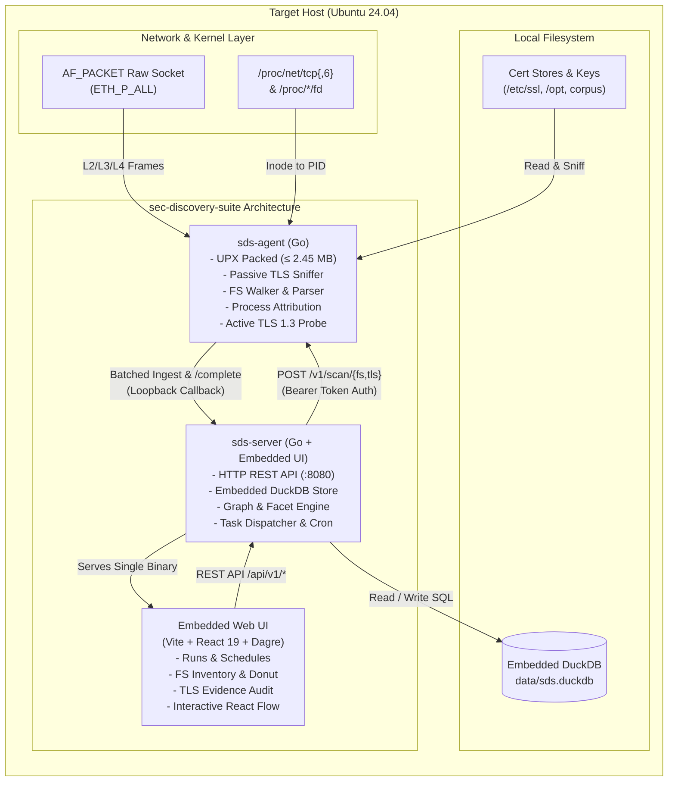

# 01 Architecture Overview

## Goal
Build a local cryptographic discovery product for ONE authorized Ubuntu host:
1. A lightweight **agent** discovers certificates on the filesystem and observes TLS
   connection metadata (metadata only, never payloads or private keys).
2. A local **backend API** starts/tracks scans, validates and stores results, serves reports.
3. An embedded **database** persists every run, certificate and TLS observation, and
   relationship-graph edges.
4. A browser **UI** shows three views: Discovery Runs, File System Scan Report,
   TLS Metadata Scan Report (with a relationship map).

Everything runs locally. No sign-in, accounts, roles, cloud, auto-update, or multi-host.

## Hard constraints
- Target OS: Ubuntu Linux (24.04 LTS). One OS only.
- Agent: Go, **delivered executable <= 5 MB** (budget: 4.5 MB after compression).
- Database: **NO SQLite.** Embedded, zero external server install.
- TLS observation: authorized host only; no payload capture, decryption, credential or
  private-key collection.
- No mock data replacing real behavior. Sample data allowed only if flagged and visibly
  labelled in the UI.
- AI-assisted development is disclosed in the README; every component must be explainable.

## System Architecture Diagram



## Tech stack
| Layer | Choice | Why |
|---|---|---|
| Agent | Go, CGO_ENABLED=0, stdlib + golang.org/x/sys/unix + go-pkcs12 | Static, tiny, correct x509 parser built in |
| Agent command channel | HTTP on 127.0.0.1:7471 + bearer token; also a CLI | Both use the same scan functions |
| Backend | Go, net/http (1.22 pattern routing), log/slog, go:embed UI | One toolchain, one process serves API + UI |
| Database | DuckDB (embedded, single file) | SQL aggregations for dashboards, ON CONFLICT upserts for dedup |
| Frontend | Vite + React + TypeScript, Tailwind, TanStack Query/Table, Recharts, React Flow | Fast builds, SPA embedded in the Go server |

Backend and agent are SEPARATE Go modules (`sds/api`, `sds/agent`) so the agent never
inherits CGO or DuckDB dependencies.

Contingency: if DuckDB cannot be built/linked in the Phase 0 spike, switch to bbolt behind
a `Store` interface with identical upsert semantics.

## Directory structure
```
sec-discovery-suite/
├── AGENTS.md
├── Makefile                  # build, size, run, seed, demo-traffic
├── README.md
├── agent/                    # module sds/agent
│   ├── cmd/sds-agent/main.go     # CLI: scan fs | scan tls | serve
│   ├── cmd/pemprobe/             # Phase 0 throwaway
│   ├── cmd/sizeprobe/            # Phase 0 size baseline
│   └── internal/
│       ├── server/               # 127.0.0.1:7471 command API
│       ├── fsscan/               # walker, magic sniffing, parsers, owner lookup
│       ├── certinfo/             # x509 -> record, PQC classification
│       ├── tlsscan/              # sniffer tiers, tlsparse, reasm, probe
│       ├── attribution/          # socket inode -> pid -> exe/unit
│       └── submit/               # batched, idempotent upload
├── api/                      # module sds/api
│   ├── cmd/sds-server/main.go
│   ├── migrations/001_init.sql
│   └── internal/{http,runs,ingest,store,scheduler,web/dist}
├── ui/                       # Vite + React + TS
├── scripts/                  # seed-certs.sh, gen-traffic.sh, check-size.sh
├── docs/
├── bin/                      # build outputs (gitignored)
└── data/                     # sds.duckdb (gitignored)
```

## Processes, ports, environment
| Process | Address | Notes |
|---|---|---|
| sds-server (API + UI) | `:8080` | Run unprivileged |
| sds-agent (serve mode) | `127.0.0.1:7471` | Needs capabilities (below) |

Env vars: `SDS_TOKEN` (shared bearer token), `SDS_AGENT_ADDR` (default `http://127.0.0.1:7471`),
`SDS_API_ADDR` (default `127.0.0.1:8080`), `SDS_DB` (default `data/sds.duckdb`).

## Run lifecycle
`queued -> running -> completed | partial | failed`
- **completed**: finished with full coverage.
- **partial**: at least one COVERAGE problem (unreadable paths, sniffer fell back to the
  last tier, PID attribution unavailable due to privileges). Reason recorded in run.
- **failed**: agent could not produce usable output.
- A malformed certificate file is a FINDING (parse_status), not a failure.

## Privilege model (document in README)
Server: unprivileged. Agent capabilities: `CAP_NET_RAW` (packet capture),
`CAP_DAC_READ_SEARCH` (read files), `CAP_SYS_PTRACE` (read other users' /proc/*/fd),
plus `CAP_BPF` + `CAP_PERFMON` for the optional eBPF tier. Via `setcap` or `sudo` for demo.

## Working rules
1. Read docs/01..05 before coding. One phase at a time.
2. Measure agent binary size after any new dependency.
3. Never log/store/transmit private-key bytes or TLS application data.
4. Generic naming only; no company/brand names in code or docs.
5. Every run records: timestamps, duration, record counts, errors, capture method.

## Phase 0 results
- **Agent size baseline**: Raw stripped sizeprobe 7,544,992 B, UPX 2,370,068 B => UPX packing is MANDATORY for the delivered agent.
- **Database driver & backend**: DuckDB driver is `github.com/duckdb/duckdb-go/v2`, backend binary ~70 MB, CGO required.

